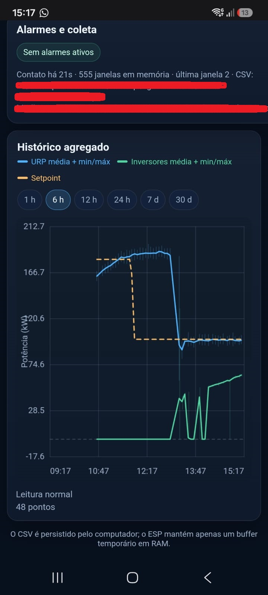
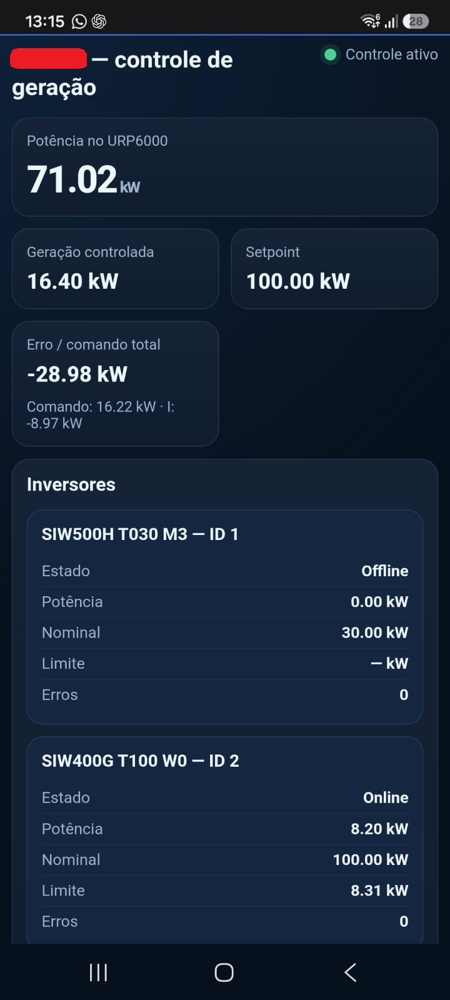

# Grid Export Lab

Acervo experimental de pesquisa sobre monitoramento e limitação de exportação de energia, com hardware Solar View reaproveitado (ESP8266), RS485 e Modbus RTU/TCP. Preserva a evolução do transporte pela rede ao monitoramento do PEXTRON URP6000-5A, gateways de comando de inversores, controle no computador e controle integrado na borda.

O controlador integrado operou com dois WEG SIW400G durante períodos de campo, mas apresentou perda persistente de comunicação RTU, recuperada ao reiniciar o ESP. A causa definitiva não foi estabelecida. Essa experiência motivou a evolução da [InverterModbusLib](https://github.com/akioShaolin/InverterModbusLib) para uma arquitetura não bloqueante. Esta importação mantém os algoritmos e dependências históricos.

Registro histórico de um período de controle: potência medida no URP6000 (azul), geração dos inversores (verde) e setpoint (amarelo). O gráfico mostra a resposta à mudança do setpoint; não comprova estabilidade contínua do sistema.

Ver painel com potências instantâneas e estado dos inversores

Registro do painel durante um período de controle ativo. O ID 1 aparece offline, conforme a limitação histórica de integração desse equipamento.

Os registros de indisponibilidade também foram preservados na [documentação de limitações](docs/known-issues.md).

| Diretório | Conteúdo |
|---|---|
| `01-rtu-tcp-tunnel` | Duas pontas do túnel binário RTU/TCP |
| `02-urp6000-monitor` | Gateways v3–v6, loggers e painel do relé |
| `03-inverter-gateway` | station e station2, comandos e feedback |
| `04-host-controller` | Controle proporcional e PI no computador |
| `05-edge-controller` | Três gerações integradas, cada uma com seu coletor e painel |
| `docs` | Inventário, compatibilidade, arquitetura e testes |
| `data` e `references` | Política de dados e referências externas |

Comece pela [cronologia](docs/timeline.md), pelo [inventário e pares compatíveis](docs/source-inventory.md) e pelo [roteiro de testes](docs/testing.md). Consulte também [limitações](docs/known-issues.md), [hardware](docs/hardware.md) e [proveniência das dependências](docs/references.md).

Antes de executar cada conjunto, revise e preencha seus arquivos locais `site_private.h` e/ou `site_private.py`, ignorados pelo Git. Para uma nova cópia do acervo, copie os respectivos `site_private.example.*` removendo `.example`. Não compartilhe esses arquivos locais. Firmwares com EEPROM preservam configuração anterior: alterações nos defaults não substituem automaticamente dados persistidos.

São versões históricas e experimentais, sem garantia de estabilidade, segurança operacional ou conformidade de proteção. Valide em bancada com supervisão técnica antes de conectar ao sistema elétrico; alterações de limite afetam equipamentos reais. Não substitui proteção elétrica nem solução certificada de exportação zero. Com o RS485 dos inversores fisicamente desconectado, a instalação descrita pelo autor apenas registra dados do relé e não controla a saída dos inversores.

Nenhum commit, push, tag ou release foi realizado nesta preparação. A publicação depende de revisão e testes humanos. Licença [MIT](LICENSE), Copyright (c) 2025 Pedro Akio Sakuma.
