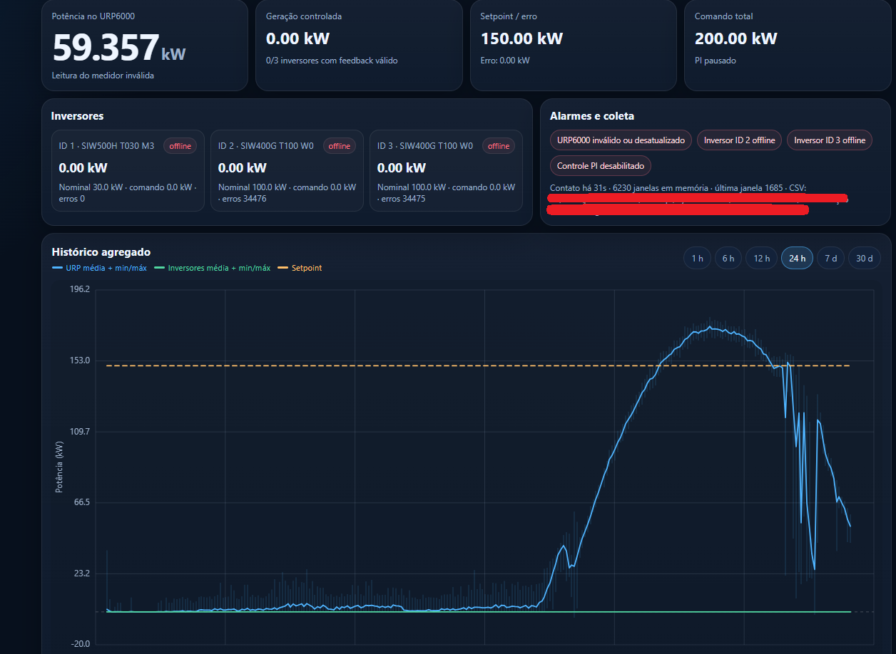

# Limitações conhecidas

O controlador integrado conseguiu controlar dois SIW400G durante períodos de teste, mas depois ambos podiam acumular erros de comunicação RTU e não recuperar normalmente. Reiniciar o ESP restabelecia comunicação. A causa definitiva não foi estabelecida; o relato não prova uma causa de software específica. O problema motivou a revisão arquitetural da InverterModbusLib e a linha refactor/nonblocking-modbus. A biblioteca não foi atualizada aqui.

Com o RS485 dos inversores desconectado, o sistema instalado descrito pelo autor apenas registra dados obtidos do relé; não controla a saída dos inversores. Esse estado é informação fornecida pelo autor, sem verificação remota nesta organização.

Registro histórico do painel com inversores offline, leitura do relé sinalizada como inválida ou desatualizada e PI pausado. A captura documenta o estado exibido, sem estabelecer a causa da indisponibilidade.

- v5 de URP contém ENABLE_RTU=0 e snapshot de teste: não tratá-lo como medição física. Logger v5 e controles do PC consomem esse formato. O autor confirmou que o PC lia o logger do URP6000 e comandava o logger dos inversores; a versão exata do firmware URP6000 usada com esses scripts não está comprovada nos fontes disponíveis.
- Status v3 fica em 0x3000, incompatível com leitores que esperam 0x0100. Snapshot 0x0200 não está exposto pelo v6.
- controle.py preserva ganhos proporcionais diferentes no caminho normal (0.20) e no caminho de cache (0.6). Unidades ambíguas em comentários/ajuda foram preservadas. Não corrigidas silenciosamente.
- EEPROM e seus valores antigos não são substituídos apenas por alterar defaults. Revisar hostnames, credenciais e configuração persistida antes de testar.
- As notas históricas contêm orientações e patches opcionais não aplicados; não comprovam que esses patches estavam instalados. CHECKSUMS antigos foram descartados após sanitização.
- Dependências antigas sem versão exata não foram resolvidas instalando versões novas. Ausência de falha sintática em Python não prova compatibilidade de API ou segurança do controle.
